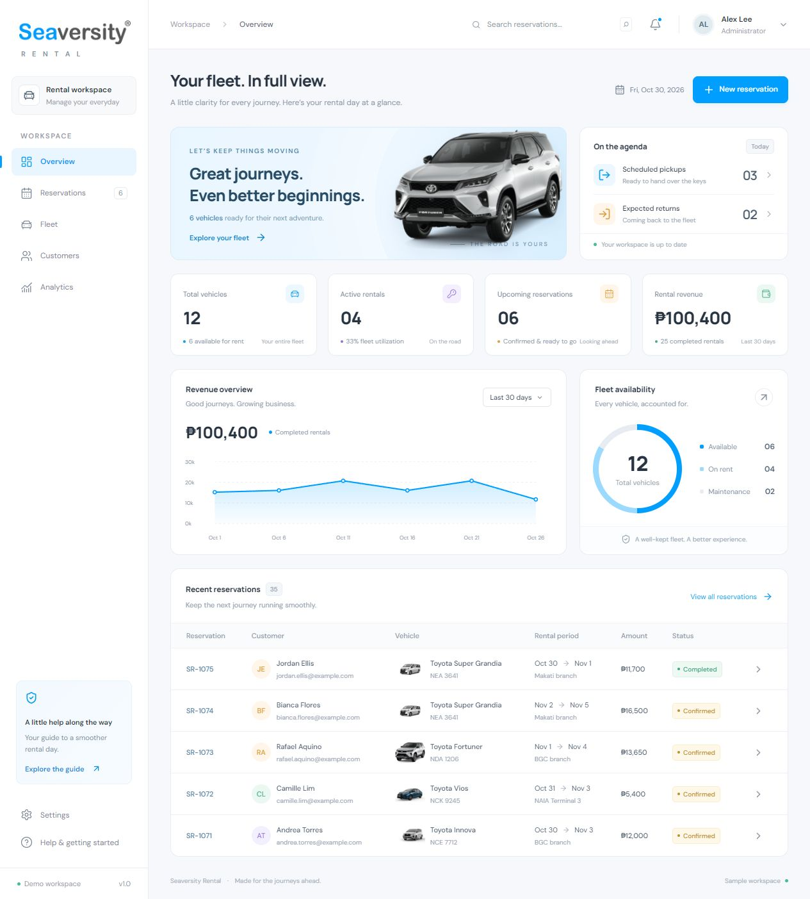

# Batch 004 — approved Seaversity Rental implementation

Approved 2026-11-03. The user explicitly asked to add the Seaversity Rental design created in this chat to their UI skill:

> Now what i want you to do is add it on my https://github.com/0phl/ui-skill, so this design is also approve on my taste you created here using also my own UI skill.

This adds **one approved implementation example**, B004-01, to the 67 supplied images in B001–B003: **68 archived images across four batches**. The new image is an unchanged capture of the working sample app, not a new user-uploaded inspiration image. Approval applies to the overall design. The user did not separately rank its fonts, colors, radii, individual controls, or other screens. See confirmed preference C08 in [the taste profile](../taste-profile.md) and the provenance and hash in [the catalog](../catalog.json).

## B004-01 — Seaversity Rental overview

The capture was created on 2026-10-30 from the local React sample car-rental workspace. It shows the overview page, with fictional data, at 1265 × 1403 pixels. The project README identifies B002-04 as guidance for dashboard hierarchy and B003-15 for navigation and aligned data rows. This is an explicitly approved application of that existing evidence, not an independent discovery of every repeated pattern.

## What to transfer

| Aspect | Observed in this implementation | Reusable application |
| --- | --- | --- |
| Shell and hierarchy | A labeled left sidebar and slim utility bar frame the title/action row, welcome and agenda panels, four KPI cards, charts, and a reservation table. | Give operational information a clear overview-to-detail sequence. Select regions for the actual task rather than requiring every dashboard to contain this exact set. |
| Clean icons | Small outline icons accompany navigation and actions; KPI icons sit in compact tinted containers. Photography and the logo have separate visual roles. | Keep functional icon weight, alignment, and icon-to-label spacing consistent. Lucide is this project's choice, not a skill-wide requirement. |
| Spacing | Shared card edges and gutters organize the grid. Titles, values, supporting labels, and table metadata form tighter internal groups. | Preserve the distinction between space within a group and space between groups; align repeated content and controls. |
| Action placement | New reservation accompanies the page title. Explore your fleet sits inside its banner. The revenue period selector belongs to the chart; View all reservations belongs to the table heading. | Place a prominent page action with page context and quieter actions beside their own panel or row. Do not turn the top-right placement into a rule for all controls. |
| Surface hierarchy | A pale canvas, white panels, fine borders, restrained shadows, and different control/card radii create separation. | Use surface, border, and elevation roles from the target design system. Soft geometry is suitable for this reference family, not mandatory across the library. |
| Brand expression | The supplied Seaversity logo, blue action/selection treatment, and contained vehicle image establish identity without competing with the working data. | Integrate the current brand in focused regions while keeping operational controls legible. A promotional panel or vehicle image is optional. |
| Data presentation | KPI values are prominent; charts retain labels and legends; table rows repeat customer, vehicle, date, amount, and textual status positions. | Keep repeated data anatomy predictable and pair status color with text. Use real product definitions for metrics and states. |

These are observed implementation choices and proposed adaptations. The confirmed feedback is that **the resulting design fits the user's taste**; it does not independently confirm every explanation in this table.

## Implementation values, not universal taste tokens

The following values were read from the local app's `src/styles.css` and `package.json` when archiving this reference. They document how this example was built; they are not measurements inferred from the JPEG and do not replace another project's tokens.

| Role | Value in Seaversity Rental |
| --- | --- |
| Brand action / deeper action | `#009fff` / `#0087dc` |
| Canvas / main text / border | `#f6f8fb` / `#293442` / `#e9edf2` |
| Heading and body families | Manrope and DM Sans |
| Utility icon package | `lucide-react` |
| Default desktop sidebar | 232 px; narrower overrides exist |
| Default content inset | 31 px top, 34 px inline |
| Four-card KPI grid | 17 px gap; 21 px following space |
| Panel / KPI / button radii | 14 px / 12 px / 8 px |
| Default button anatomy | 8 px icon-label gap; 11 × 15 px padding; 38 px minimum height |

For a similar admin or rental brief, use this example as a concrete starting point alongside B002-04 and B003-15. Adapt the grid, density, type sizes, and semantic colors to the new requirements. The blue palette follows the Seaversity logo requested for this project. Approval does not establish blue, a light theme, these font families, React, or these pixel values as defaults for unrelated projects.

## Scope, provenance, and limitations

- The archived file is the original `qa/overview.jpg` capture, preserved byte-for-byte. It is a full-page desktop capture, not browser chrome or a multi-screen collage.
- Only the overview is archived as visual evidence. The app also contains reservations, fleet, customers, analytics, and settings, but this image does not document their appearance or supply separate approvals.
- Source inspection shows responsive rules, a narrow-screen navigation drawer, focus styles, native dialogs, and reduced-motion rules. Those source facts do not make this still image proof of behavior or accessibility. Validate those properties in each implementation.
- Some secondary labels are small and faint. Overall approval is not a reason to copy weak contrast or reduce readable type size. Preserve the hierarchy while meeting the target product's accessibility requirements.
- The business records, administrator identity, revenue, counts, and dates are sample data. They are not real customer records or live business claims.
- The Seaversity logo was supplied by the user. The vehicle imagery comes from Toyota Makati: [Fortuner](https://toyotamakati.com.ph/fortuner/), [Vios](https://toyotamakati.com.ph/vios/), [Innova](https://toyotamakati.com.ph/innova/), and the [Super Grandia image source page](https://toyotamakati.com.ph/camry/). Screenshot inclusion does not grant a license to reuse that imagery or branding. See [third-party notices](../../../THIRD_PARTY_NOTICES.md).
- This batch is a portable design reference. It does not bundle the app, depend on a live deployment, or authorize hosting. The user requested local-only app work and removed its earlier hosted copy; adding this reference to GitHub does not change that instruction.

## Profile change

C08 records explicit approval of Seaversity Rental as a completed design made using this skill. It gives the modular-dashboard family a concrete approved implementation. C04's icon, spacing, action-placement, and overall-composition priorities and C05's theme flexibility continue to govern future work.
