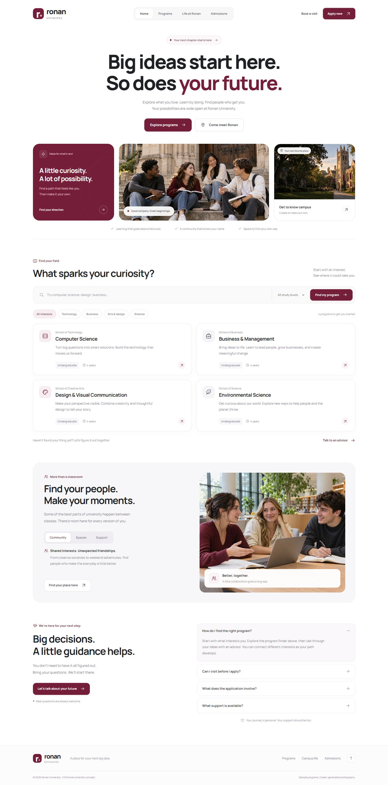

# Batch 005 — approved Ronan University redesign

Created and approved 2026-11-03. The user reviewed the rebuilt Ronan University landing page and explicitly requested:

> now add this design also as passed on my reference. update and add this to my UI skill.

**Outcome: passed / approved.** This is the second Ronan design, B005-01. The first design remains rejected as [R001](../rejections/ronan-university.md). Approval of this replacement does not reverse that rejection.

This adds one approved implementation outcome and one archived image. The library now has 69 images: 67 submitted references, the approved Seaversity capture in B004, and this Ronan capture. The reused reference patterns are not additional independent preference votes. See C10 in [the taste profile](../taste-profile.md) and the image metadata in [the catalog](../catalog.json).

## B005-01 — Ronan University, second design

The full-page desktop screenshot is preserved unchanged at 1425 × 2883 pixels, captured with a 1440 × 1000 browser viewport on 2026-11-03. The 15-pixel difference in capture width is the browser scrollbar. It shows the approved page from the header through the footer. After approving the design, the user asked to replace the mobile-sized reference with a desktop or big-screen image; this capture replaces the earlier 453 × 3805 screenshot under the same B005-01 ID. It is the same approved implementation, not a new design or an additional preference vote.

The implementation draws on B002-22 for centered messaging and rounded controls, B002-26 for grouped photography, B002-13 for clear sans-serif hierarchy, and B004-01 for spacing and component treatment. The screenshot is evidence of how the resulting page looks; the following transfer guidance is analysis, not a list of separately confirmed likes.

## What to transfer

| Aspect | Observed in the approved design | Reusable application |
| --- | --- | --- |
| Typography and hierarchy | Strong sans-serif headings, a compact wordmark, sentence-case labels, and quieter supporting text. The centered hero reads “Big ideas start here. So does your future.” | Use a deliberate type hierarchy with a clear focal message. This is a concrete approved alternative to R001's thin serif/italic system; Manrope is not required for every project. |
| Navigation and actions | A light header separates the identity, centered navigation group, Book a visit, and Apply now actions. Paired hero actions sit directly beneath the message. | Keep the main action easy to find and secondary actions near their context. Adapt navigation density to the available width. |
| Geometry | Rounded buttons, pills, icon tiles, photographs, program cards, and FAQ panels share a coherent family of shapes. | Coordinate corner treatment across components while preserving their hierarchy. This is an approved softer treatment for a comparable landing page, not a universal radius specification. |
| Photography and composition | A three-column row places a maroon message card beside a wider student photograph and a smaller campus preview, each in a contained rounded panel. A study-space photograph supports the campus-life section. | Give imagery a contained role alongside message and action groups. Use the content and viewport to decide the arrangement. |
| Spacing and icons | Broad intervals separate sections; tighter gaps bind labels, headings, descriptions, metadata, and local actions. Small outline icons have consistent weight and placement. | Preserve grouped spacing and predictable alignment rather than copying isolated pixel values. Use icons where they clarify the task. |
| Program discovery | A compact search/level form and category pills precede a two-column program grid. Cards repeat a title, description, metadata, and local arrow. | Place discovery controls directly above their results and repeat card anatomy consistently. The screenshot records the initial state only. |
| Campus life and admissions | A softly contained campus section places tabs and copy beside photography. Admissions pairs guidance and a local action with rounded FAQs in a second column. | Vary section composition while keeping message/action relationships clear. The exact sections and their order are project choices. |
| Brand | White surfaces, dark text, and concentrated maroon accents express the requested palette. | Follow the current project's brand requirements. This approval does not establish maroon or a light theme as universal preferences. |

## Source-derived implementation facts

These facts were read from the approved page's source; they are not measurements inferred from the screenshot or new global taste rules.

- Font: locally bundled Manrope at weights 400, 600, 700, and 800.
- Primary maroon: `#741e3a`; main text: `#202124`; surface: `#f8f8fa`; border: `#eae9ec`.
- Default container: 1256 px maximum including 36 px inline padding; narrow layout uses 20 px padding.
- Default button radius: 12 px; hero photo/card radius: 24 px. Narrow-layout overrides include 10 px hero buttons, 19 px hero panels, and 16 px program cards.
- The wide-layout source defines the three-column photo group, two-column program grid, and paired campus/admissions regions visible in this desktop capture. Narrow-layout rules reflow the student photo above two smaller cards and stack the program cards and later sections; those responsive transitions are not established by this desktop image.
- The source implements program search and filters, program details, campus tabs, FAQs, responsive navigation, and browser-only demonstration forms. These are not separate visual approvals or verified behavioral claims.

## How this resolves the Ronan feedback

Use B005-01 as the approved Ronan reference for comparable public-page work. It changes the overall composition, type system, header, image placement, component geometry, and section treatment. Do not summarize the improvement as a font swap or rounded corners applied to R001's existing structure.

The black/white/maroon brief is retained. The redesign also reuses the original generated campus and student photographs in new arrangements and adds a generated study-space image. This demonstrates that the accepted result is a different composition under the same brief; it does not establish which individual change caused approval. R001's explicit typography and sharp-edge complaints remain negative evidence for that version.

## Provenance and limits

- Creator: Codex, implementing the user's fictional Ronan University sample. The user explicitly approved the completed redesign, with no new feature-by-feature ranking.
- All three photographs were made with built-in Codex Image Gen. Two were reused from the first version; the modern study-space image was generated for the rebuild. Reference-library inspiration images are not page assets.
- The archived capture is a portable reference and requires no localhost server. This batch does not bundle or publish the sample application itself.
- University content and program information are fictional. Forms do not submit or store data.
- Some secondary labels are small and faint. Overall approval does not require reproducing low readability. Adapt contrast and type size to the actual product.
- No automated tests were run, as requested. A still screenshot does not prove keyboard behavior, responsiveness across widths, performance, or accessibility. The current B005-01 image documents the captured desktop layout and initial state.
- Exact source hashes and image dimensions, size, and SHA-256 are recorded in the catalog. Approval of this outcome does not make its font, framework, palette, images, or dimensions mandatory elsewhere.
